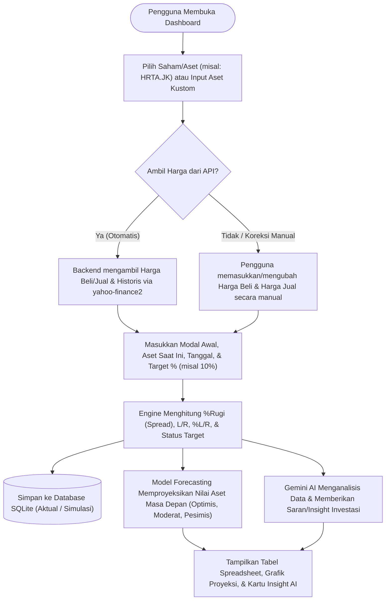

# Business Requirements Document (BRD)
## Proyek: Dashboard Monitoring, Simulasi Kalkulasi, & Forecasting Portofolio Investasi

| Atribut Dokumen | Detail |
| :--- | :--- |
| **Nama Proyek** | Dashboard Kalkulasi & Forecasting Portofolio Saham/Aset (Berbasis AI) |
| **Versi Dokumen** | 1.0 |
| **Tanggal** | 9 November 2026 |
| **Status** | Disetujui untuk Perencanaan (Pre-Execution) |
| **Lingkup Penggunaan** | Personal Portfolio Monitoring & Financial Simulation |

---

## 1. Ringkasan Eksekutif (*Executive Summary*)

Pengelolaan dan pemantauan perkembangan investasi pribadi—baik berupa saham di Bursa Efek Indonesia (BEI/IDX) maupun aset seperti emas/logam mulia (contoh: `HRTA`)—sering kali dilakukan secara manual menggunakan *spreadsheet*. Pendekatan manual tersebut memiliki beberapa keterbatasan utama:
1. **Ketergantungan pada Input Harga Manual**: Pengguna harus mengecek dan mengetik harga beli (*buy/ask*) serta harga jual (*sell/bid/buyback*) satu per satu.
2. **Keterbatasan Simulasi ("Angan-Angan" / *What-If Analysis*)**: Sulit melakukan simulasi cepat untuk menguji berbagai skenario modal awal, perubahan harga pasar, dan target persentase keuntungan tanpa merusak data pencatatan utama di *spreadsheet*.
3. **Tidak Adanya Proyeksi Masa Depan (*Forecasting*)**: *Spreadsheet* statis hanya menampilkan kondisi saat ini (*snapshot*) tanpa memberikan gambaran proyeksi nilai aset di masa mendatang berdasarkan tren pergerakan harga.
4. **Kurangnya Rekomendasi Analitis**: Angka laba/rugi dan persentase *spread* belum diterjemahkan menjadi saran strategis yang membantu pengambilan keputusan.

Proyek ini bertujuan membangun **Dashboard Portofolio Berbasis Web (React + TypeScript)** yang mengintegrasikan **data pasar saham open-source**, **mesin kalkulasi otomatis berbasis struktur spreadsheet referensi**, **model *forecasting* sederhana**, penyimpanan lokal **SQLite**, serta **asisten analisis berbasis Google Gemini AI**.

---

## 2. Tujuan Bisnis (*Business Objectives*)

1. **BO-01 — Otomatisasi & Fleksibilitas Data Harga Pasar**:
   Menyediakan harga beli dan harga jual saham secara otomatis melalui API open-source (`yahoo-finance2` untuk saham BEI/IDX), sekaligus tetap mendukung input/koreksi harga secara manual untuk aset khusus (seperti harga beli vs *buyback* emas fisik/digital atau skenario simulasi bebas).
2. **BO-02 — Standardisasi & Kecepatan Kalkulasi Portofolio**:
   Mengotomatiskan seluruh rumus pada tabel referensi *spreadsheet* (`BELI`, `JUAL`, `%RUGI`, `TANGGAL`, `ASET SAAT INI`, `MODAL AWAL`, `L/R`, `%L/R`, dan `TARGET >X%`) secara *real-time* dan bebas dari kesalahan rumus manual.
3. **BO-03 — Fasilitasi Simulasi Keuangan ("Angan-Angan")**:
   Memungkinkan pengguna memproyeksikan hasil investasi dengan mengubah variabel modal awal, nilai aset, harga beli/jual, dan target persentase keuntungan secara interaktif sebelum mengambil keputusan finansial nyata.
4. **BO-04 — Visibilitas Perkembangan Keuangan Masa Depan (*Forecasting*)**:
   Menyajikan estimasi pertumbuhan nilai aset untuk horizon waktu ke depan (1 bulan hingga 1 tahun) dalam skenario *Optimis*, *Moderat*, dan *Pesimis*.
5. **BO-05 — Pengambilan Keputusan Berbantuan AI (*AI-Driven Insights*)**:
   Memanfaatkan **Google Gemini AI** untuk memberikan evaluasi posisi portofolio, analisis beban *spread* (`%RUGI`), serta langkah strategis guna mencapai target keuntungan (misal `>10%`).

---

## 3. Referensi Logika Bisnis (Studi Kasus Spreadsheet)

Sistem mengadopsi dan memperluas logika bisnis dari tabel referensi pengguna (contoh pada aset/saham `HRTA`):

| BELI | JUAL | %RUGI | TANGGAL | ASET SAAT INI | MODAL AWAL | L/R | %L/R | TARGET >10% |
| :--- | :--- | :--- | :--- | :--- | :--- | :--- | :--- | :--- |
| `2.455.000` | `2.375.000` | `3,26%` | `9 November` | `2.072.900` | `2.100.000` | `-27.100,00` | `-1,29%` | `Belum Tercapai` |

### Definisi Aturan Bisnis Utama:
- **`BELI`**: Harga perolehan / harga beli aset atau saham di pasar saat ini.
- **`JUAL`**: Harga jual kembali (*buyback* / *bid*) aset atau saham di pasar saat ini.
- **`%RUGI` (*Spread*)**: Persentase selisih antara harga beli dan harga jual terhadap harga beli:
  $$\text{\%RUGI} = \frac{\text{BELI} - \text{JUAL}}{\text{BELI}} \times 100\%$$
- **`MODAL AWAL`**: Nilai uang/modal yang diinvestasikan (aktual maupun simulasi angan-angan).
- **`ASET SAAT INI`**: Nilai valuasi portofolio saat ini (dapat diinput langsung oleh pengguna atau dihitung otomatis dari konversi unit/lot terhadap harga jual).
- **`L/R` (Laba/Rugi Nominal)**: Selisih antara `ASET SAAT INI` dengan `MODAL AWAL`:
  $$\text{L/R} = \text{ASET SAAT INI} - \text{MODAL AWAL}$$
- **`%L/R` (Persentase Laba/Rugi)**: Rasio `L/R` terhadap `MODAL AWAL`:
  $$\text{\%L/R} = \frac{\text{L/R}}{\text{MODAL AWAL}} \times 100\%$$
- **`TARGET (>X%)`**: Indikator pencapaian target investasi. Default target adalah `10%` (dapat diubah pengguna). Jika $\text{\%L/R} \ge \text{Target}$, maka status **`Tercapai`**, selain itu **`Belum Tercapai`**.

---

## 4. Ruang Lingkup Proyek (*Project Scope*)

### 4.1. Termasuk dalam Ruang Lingkup (*In-Scope*)
- **Dashboard Monitoring Portofolio**: Antarmuka web yang menampilkan ringkasan portofolio dan tabel interaktif sesuai kolom *spreadsheet*.
- **Integrasi API Saham Open-Source**: Pengambilan data harga saham Indonesia (`.JK`) dan data historis melalui backend menggunakan `yahoo-finance2`.
- **Kalkulator Simulasi ("Angan-Angan")**: Formulir & *slider* interaktif untuk mencoba berbagai kombinasi modal awal, harga pasar, dan target persentase keuntungan.
- **Modul Forecasting Sederhana**: Perhitungan proyeksi nilai aset ke depan berdasarkan tren historis (*Linear Trend / CAGR & Volatility*) serta simulasi pertumbuhan majemuk.
- **Integrasi Google Gemini AI**: Analisis otomatis dan pemberian saran investasi dengan `GEMINI_API_KEY` yang diamankan pada file `.env` di sisi backend.
- **Penyimpanan Lokal Persisten (SQLite)**: Penyimpanan data *watchlist*, riwayat kalkulasi/simulasi, dan *cache* insight AI menggunakan database **SQLite** di sisi backend.
- **Ekspor Data (CSV)**: Kemampuan mengunduh tabel kalkulasi kembali ke format CSV agar tetap kompatibel dengan *spreadsheet* (Excel/Google Sheets).

### 4.2. Di Luar Ruang Lingkup (*Out-of-Scope*)
- Integrasi langsung ke akun sekuritas/broker untuk eksekusi order beli/jual otomatis (*auto-trading*).
- Sistem manajemen pengguna multi-tenant atau gerbang pembayaran (*payment gateway*).
- Data *tick-by-tick order book* berbayar tingkat institusi (fokus pada data kuotasi dan penutupan harian open-source).

---

## 5. Alur Proses Bisnis (*Business Process Flow*)

---

## 6. Daftar Kebutuhan Bisnis (*Business Requirements*)

| ID | Kebutuhan Bisnis | Deskripsi | Prioritas |
| :--- | :--- | :--- | :--- |
| **BR-01** | **Pencatatan & Kalkulasi Kolom Spreadsheet** | Sistem harus menyediakan seluruh parameter dan hasil kalkulasi sesuai tabel referensi (`BELI`, `JUAL`, `%RUGI`, `TANGGAL`, `ASET SAAT INI`, `MODAL AWAL`, `L/R`, `%L/R`, `TARGET`). | **Tinggi (Must Have)** |
| **BR-02** | **Mode Simulasi "Angan-Angan" (*What-If*)** | Pengguna dapat melakukan uji coba perhitungan modal dan target tanpa harus memiliki aset tersebut terlebih dahulu, serta membedakan antara catatan aktual vs simulasi. | **Tinggi (Must Have)** |
| **BR-03** | **Koneksi Data Saham Open-Source** | Sistem dapat mengambil harga saham populer di BEI (seperti `HRTA.JK`, `BBCA.JK`, `ANTM.JK`, `BMRI.JK`, `TLKM.JK`, dll.) secara otomatis dan gratis. | **Tinggi (Must Have)** |
| **BR-04** | **Model Forecasting Perkembangan Keuangan** | Sistem harus mampu memproyeksikan nilai aset di masa depan dan mengestimasi kapan target keuntungan (misal `>10%`) dapat tercapai. | **Tinggi (Must Have)** |
| **BR-05** | **Rekomendasi & Insight Berbasis Gemini AI** | Sistem memberikan saran dan *insight* yang relevan berdasarkan hasil kalkulasi, tingkat kerugian *spread*, dan target pengguna menggunakan API Gemini AI. | **Tinggi (Must Have)** |
| **BR-06** | **Penyimpanan Lokal dengan SQLite** | Seluruh catatan kalkulasi dan *watchlist* disimpan di database SQLite lokal agar data tidak hilang saat browser ditutup. | **Tinggi (Must Have)** |
| **BR-07** | **Keamanan Kredensial API Key** | `GEMINI_API_KEY` wajib disimpan di sisi server (`.env` backend) dan tidak diekspos ke kode frontend/browser. | **Tinggi (Must Have)** |
| **BR-08** | **Ekspor ke Spreadsheet (CSV)** | Pengguna dapat mengekspor tabel hasil kalkulasi menjadi file CSV untuk dokumentasi cadangan di Excel/Spreadsheet. | **Sedang (Should Have)** |

---

## 7. Indikator Keberhasilan (*Success Metrics*)

1. **Akurasi Kalkulasi 100%**: Hasil perhitungan `%RUGI`, `L/R`, `%L/R`, dan status `TARGET` di dashboard identik 100% dengan perhitungan pada *spreadsheet* referensi pengguna.
2. **Kecepatan Simulasi (< 1 Detik)**: Perubahan input pada kalkulator "angan-angan" langsung memperbarui metrik laba/rugi dan grafik proyeksi dalam waktu kurang dari 1 detik.
3. **Kemudahan Penggunaan (*User-Friendly*)**: Seluruh komponen utama (Ringkasan KPI, Kalkulator Input, Tabel Spreadsheet, Grafik Forecasting, dan Saran AI) dapat diakses dalam satu halaman dashboard yang rapi dan intuitif.

---

## 8. Analisis Risiko & Mitigasi

| Risiko | Dampak | Strategi Mitigasi |
| :--- | :--- | :--- |
| **Keterbatasan / Gangguan pada API Saham Gratis (`yahoo-finance2`)** | Harga saham tidak dapat dimuat otomatis saat server eksternal *down* atau *rate-limited*. | Menyimpan harga terakhir (*cache*) di SQLite dan selalu mengaktifkan kolom input/edit manual untuk Harga Beli & Jual. |
| **Perbedaan Harga Saham (`HRTA.JK`) vs Emas Fisik HRTA** | Harga saham per lembar berbeda dengan harga emas batangan per gram yang memiliki *spread buyback* sekitar 3%. | Mendukung mode pengisian manual pada Harga Beli & Harga Jual serta menyediakan kalkulator konversi unit/gram opsional. |
| **Batas Kuota Request Gemini AI (Rate Limit Free Tier)** | Permintaan analisis AI gagal jika dipanggil berulang kali secara berlebihan dalam waktu singkat. | Menerapkan tombol pemicu eksplisit (*"Analisis dengan AI"*) dan menyimpan hasil respons AI di database SQLite untuk data kalkulasi yang sama. |
