# Product Requirements Document (PRD)
## Proyek: Dashboard Monitoring, Simulasi Kalkulasi, & Forecasting Portofolio Investasi

| Atribut Dokumen | Detail |
| :--- | :--- |
| **Nama Produk** | NgeTarget Saham — Dashboard Kalkulasi & Forecasting Portofolio |
| **Versi Dokumen** | 1.0 |
| **Tanggal** | 9 November 2026 |
| **Tech Stack Utama** | React + TypeScript (Frontend), Node.js + Express + TypeScript (Backend), SQLite + Prisma (Database), `yahoo-finance2` (Market Data), `@google/genai` (Gemini AI) |

---

## 1. Ikhtisar Produk (*Product Overview*)

**NgeTarget Saham** adalah aplikasi dashboard berbasis web yang dirancang untuk memonitor perkembangan investasi pribadi sekaligus melakukan simulasi kalkulasi keuangan (*"angan-angan" / what-if simulation*). Aplikasi ini menggabungkan struktur tabel *spreadsheet* portofolio yang familiar (`BELI`, `JUAL`, `%RUGI`, `TANGGAL`, `ASET SAAT INI`, `MODAL AWAL`, `L/R`, `%L/R`, `TARGET >10%`) dengan:
1. Pengambilan data harga saham otomatis dari API open-source (`yahoo-finance2` untuk saham BEI/IDX).
2. Model *forecasting* sederhana untuk memproyeksikan perkembangan keuangan di masa depan.
3. Rekomendasi dan *insight* otomatis dari **Google Gemini AI** yang terintegrasi melalui `.env` di sisi backend.
4. Penyimpanan lokal persisten menggunakan **SQLite**.

---

## 2. User Stories & Kriteria Penerimaan (*Acceptance Criteria*)

### US-01: Pemilihan Saham/Aset & Pengambilan Harga Pasar
- **Sebagai** pengguna, **saya ingin** memilih saham dari daftar emiten BEI (misalnya `HRTA.JK`, `ANTM.JK`, `BBCA.JK`, `BMRI.JK`, `TLKM.JK`, dll.) atau memasukkan nama aset kustom, **sehingga** Harga Beli dan Harga Jual dapat terisi otomatis melalui API maupun dikoreksi secara manual.
- **Kriteria Penerimaan**:
  1. Tersedia *dropdown/combobox* daftar saham populer IDX (`.JK`) disertai fitur pencarian ticker.
  2. Saat saham dipilih dan tombol *"Ambil Harga Pasar"* diklik, sistem mengambil harga pasar terkini dari backend (`yahoo-finance2`).
  3. Pengguna tetap dapat mengetik atau mengubah nilai **Harga Beli (`BELI`)** dan **Harga Jual (`JUAL`)** secara manual (misalnya untuk memasukkan harga beli/buyback emas HRTA `2.455.000` dan `2.375.000`).

### US-02: Kalkulasi Portofolio & Simulasi "Angan-Angan" (*What-If*)
- **Sebagai** pengguna, **saya ingin** memasukkan nilai `Modal Awal`, `Aset Saat Ini`, `Target Persentase`, dan `Tanggal`, **sehingga** sistem otomatis menghitung `%Rugi` (*spread*), `L/R`, `%L/R`, dan status pencapaian target secara *real-time*.
- **Kriteria Penerimaan**:
  1. Tersedia 2 mode pengisian `ASET SAAT INI`:
     - **Mode Input Langsung (Sesuai Spreadsheet)**: Pengguna mengetik langsung nilai `Modal Awal` (misal `2.100.000`) dan `Aset Saat Ini` (misal `2.072.900`).
     - **Mode Otomatis Berbasis Spread/Unit**: `Aset Saat Ini` dihitung otomatis berdasarkan rasio harga jual terhadap harga beli atau jumlah unit/lot yang dimiliki.
  2. Tersedia *slider* interaktif pada mode *"Simulasi Angan-Angan"* untuk menggeser proyeksi perubahan harga jual (`-20%` s/d `+50%`) atau perubahan modal awal dan melihat dampaknya langsung pada `L/R` serta status `TARGET`.
  3. Contoh data referensi wajib menghasilkan output presisi:
     - Input: `BELI = 2.455.000`, `JUAL = 2.375.000`, `TANGGAL = 9 November`, `ASET SAAT INI = 2.072.900`, `MODAL AWAL = 2.100.000`, `TARGET = 10%`
     - Output: `%RUGI = 3,26%`, `L/R = -Rp 27.100,00`, `%L/R = -1,29%`, `TARGET >10% = Belum Tercapai`.

### US-03: Tabel Monitoring Portofolio Berbasis Spreadsheet
- **Sebagai** pengguna, **saya ingin** melihat seluruh catatan portofolio dan simulasi saya dalam satu tabel terstruktur yang mencakup semua kolom *spreadsheet*, **sehingga** saya dapat membandingkan performa antar saham/aset maupun antar tanggal.
- **Kriteria Penerimaan**:
  1. Tabel menampilkan kolom: `SAHAM/ASET`, `BELI`, `JUAL`, `%RUGI`, `TANGGAL`, `ASET SAAT INI`, `MODAL AWAL`, `L/R`, `%L/R`, `TARGET (>X%)`, dan `AKSI`.
  2. Nilai `L/R` dan `%L/R` berwarna **hijau** jika positif ($\ge 0$) dan **merah** jika negatif ($< 0$).
  3. Kolom `TARGET` menampilkan *badge* hijau **`Tercapai`** jika $\text{\%L/R} \ge \text{Target \%}$ atau *badge* kuning/merah **`Belum Tercapai`** beserta informasi kekurangan nominal menuju target.
  4. Pengguna dapat menyimpan baris baru ke database SQLite, memilih baris untuk dianalisis/diforecast, menghapus baris, dan mengekspor tabel ke file `.csv`.

### US-04: Proyeksi Perkembangan Keuangan (*Forecasting*)
- **Sebagai** pengguna, **saya ingin** melihat grafik *forecasting* perkembangan nilai aset saya di masa depan (1, 3, 6, hingga 12 bulan ke depan), **sehingga** saya memiliki gambaran kapan modal saya berpotensi mencapai target keuntungan `>10%`.
- **Kriteria Penerimaan**:
  1. Grafik menampilkan proyeksi nilai aset dalam 3 skenario: **Optimis (*Bullish*)**, **Moderat (*Base Case*)**, dan **Pesimis (*Bearish*)**.
  2. Grafik menampilkan garis horizontal referensi untuk **`MODAL AWAL`** (titik impas / *Break-Even Point*) dan **`TARGET ASET`** (misal $\text{Rp } 2.310.000$ untuk modal $\text{Rp } 2.100.000$ dengan target $10\%$).
  3. Sistem menampilkan estimasi waktu/bulan pencapaian target berdasarkan tren historis saham atau asumsi pertumbuhan tahunan (*CAGR/Expected Return*) yang dapat disesuaikan pengguna.

### US-05: Saran & Insight Otomatis dari Gemini AI
- **Sebagai** pengguna, **saya ingin** mendapatkan analisis, evaluasi risiko, dan saran tindakan dari AI berdasarkan angka kalkulasi saya, **sehingga** saya bisa menyusun strategi investasi yang lebih terukur.
- **Kriteria Penerimaan**:
  1. Saat pengguna menekan tombol **"Minta Saran Gemini AI"** pada kalkulasi aktif atau baris tabel, sistem mengirimkan parameter portofolio ke backend (`/api/ai/insight`).
  2. Backend memanggil model Gemini (`gemini-3.8-flash`) menggunakan `GEMINI_API_KEY` dari file `.env`.
  3. Panel AI menampilkan:
     - **Ringkasan Kondisi Portofolio** (evaluasi posisi *floating loss/profit* dan *spread* `%RUGI`).
     - **Strategi Pencapaian Target** (berapa persen kenaikan harga yang dibutuhkan untuk menutup *spread* + mencapai target `>10%`).
     - **Saran & Manajemen Risiko** (*Hold*, *Average Down*, atau penyesuaian horizon waktu).

---

## 3. Spesifikasi Fungsional & Rumus Matematika

### 3.1. Mesin Kalkulasi Portofolio (*Portfolio Calculation Engine*)

| Nama Variabel | Kolom Spreadsheet | Tipe | Rumus / Aturan Perhitungan |
| :--- | :--- | :--- | :--- |
| `buyPrice` | `BELI` | Input (`number`) | Harga beli per unit/lembar/gram ($\text{BELI} > 0$). |
| `sellPrice` | `JUAL` | Input (`number`) | Harga jual/buyback saat ini ($\text{JUAL} \ge 0$). |
| `spreadLossPct` | `%RUGI` | Output (`number`) | $\frac{\text{buyPrice} - \text{sellPrice}}{\text{buyPrice}} \times 100$ |
| `recordDate` | `TANGGAL` | Input (`string`) | Tanggal pencatatan atau simulasi. |
| `currentAsset` | `ASET SAAT INI` | Input/Auto (`number`) | Input langsung oleh pengguna, atau jika mode otomatis: $\text{initialCapital} \times \frac{\text{sellPrice}}{\text{buyPrice}}$ |
| `initialCapital` | `MODAL AWAL` | Input (`number`) | Nilai modal awal yang diinvestasikan ($\text{MODAL AWAL} > 0$). |
| `profitLoss` | `L/R` | Output (`number`) | $\text{currentAsset} - \text{initialCapital}$ |
| `profitLossPct` | `%L/R` | Output (`number`) | $\frac{\text{profitLoss}}{\text{initialCapital}} \times 100$ |
| `targetPct` | `TARGET >X%` | Input (`number`) | Persentase target keuntungan (default: `10`). |
| `targetAssetValue` | *(Info Tambahan)* | Output (`number`) | $\text{initialCapital} \times \left(1 + \frac{\text{targetPct}}{100}\right)$ |
| `shortfallToTarget` | *(Info Tambahan)* | Output (`number`) | $\max(0, \text{targetAssetValue} - \text{currentAsset})$ |
| `requiredPriceForTarget` | *(Info Tambahan)* | Output (`number`) | $\text{sellPrice} \times \frac{\text{targetAssetValue}}{\text{currentAsset}}$ |
| `isTargetMet` | `TARGET >10%` | Output (`boolean`) | `true` (`"Tercapai"`) jika $\text{profitLossPct} \ge \text{targetPct}$, selain itu `false` (`"Belum Tercapai"`). |

---

### 3.2. Spesifikasi Model Forecasting Sederhana

Model *forecasting* menggunakan kombinasi **Data Historis Saham (jika ticker IDX dipilih)** dan **Parameter Pertumbuhan/Setoran Bulanan (DCA)**:

1. **Perhitungan Drift ($\mu$) & Volatilitas ($\sigma$) dari Data Historis**:
   - Dari $N$ hari perdagangan terakhir (default $N = 90$ hari) harga penutupan $P_t$, dihitung *daily return* $r_t = \frac{P_t - P_{t-1}}{P_{t-1}}$.
   - Rata-rata return harian: $\bar{r} = \frac{1}{N}\sum r_t$ (dibatasi pada rentang realistis agar tidak ekstrem akibat *outlier* sesaat).
   - Standar deviasi harian: $\sigma = \sqrt{\frac{1}{N-1}\sum (r_t - \bar{r})^2}$.
2. **Proyeksi Nilai Aset pada Bulan ke-$m$ ($t = 21 \times m$ hari bursa)**:
   - **Skenario Moderat (*Base Case*)**:
     $$V_{\text{base}}(t) = \text{ASET SAAT INI} \times (1 + \bar{r})^t + \text{Simulasi Setoran Bulanan}$$
   - **Skenario Optimis (*Bullish*)**:
     $$V_{\text{bull}}(t) = \text{ASET SAAT INI} \times (1 + \bar{r})^t \times (1 + 0.5 \cdot \sigma \sqrt{t})$$
   - **Skenario Pesimis (*Bearish*)**:
     $$V_{\text{bear}}(t) = \text{ASET SAAT INI} \times (1 + \bar{r})^t \times (1 - 0.5 \cdot \sigma \sqrt{t})$$
3. **Mode Fallback / Custom Return**:
   - Jika pengguna memasukkan aset manual atau ingin mengatur asumsi return sendiri (misal pertumbuhan emas rata-rata `12%` per tahun), pengguna dapat mengatur *slider* **Asumsi Return Tahunan (%)** untuk melihat kurva proyeksi secara interaktif.

---

## 4. Arsitektur Teknis, Skema Database (SQLite), & Kontrak API

### 4.1. Struktur Folder Proyek
```text
kalkulasi-saham/
├── docs/
│   ├── BRD.md
│   └── PRD.md
├── backend/
│   ├── prisma/
│   │   └── schema.prisma       # Skema SQLite
│   ├── src/
│   │   ├── index.ts            # Entry point Express server
│   │   ├── routes/             # Endpoint API (stocks, portfolio, forecast, ai)
│   │   ├── services/
│   │   │   ├── calculation.ts  # Engine rumus spreadsheet & simulasi
│   │   │   ├── forecasting.ts  # Engine proyeksi masa depan
│   │   │   ├── marketData.ts   # Integrasi yahoo-finance2 + daftar saham IDX
│   │   │   └── geminiAi.ts     # Integrasi @google/genai
│   │   └── types/
│   ├── .env                    # Menyimpan GEMINI_API_KEY, PORT, DATABASE_URL
│   ├── .env.example
│   └── package.json
└── frontend/
    ├── src/
    │   ├── components/
    │   │   ├── SummaryCards.tsx
    │   │   ├── CalculatorForm.tsx
    │   │   ├── WhatIfSimulator.tsx
    │   │   ├── PortfolioTable.tsx
    │   │   ├── ForecastChart.tsx
    │   │   └── AiInsightCard.tsx
    │   ├── services/api.ts
    │   ├── types/portfolio.ts
    │   ├── App.tsx
    │   └── main.tsx
    └── package.json
```

### 4.2. Skema Database SQLite (`backend/prisma/schema.prisma`)
```prisma
datasource db {
  provider = "sqlite"
  url      = env("DATABASE_URL") // default: "file:./dev.db"
}

generator client {
  provider = "prisma-client-js"
}

model PortfolioRecord {
  id                 String   @id @default(uuid())
  symbol             String   // Contoh: "HRTA.JK" atau "HRTA (Emas)"
  assetName          String   // Contoh: "PT Hartadinata Abadi Tbk"
  buyPrice           Float    // BELI (contoh: 2455000)
  sellPrice          Float    // JUAL (contoh: 2375000)
  spreadLossPct      Float    // %RUGI (contoh: 3.26)
  recordDate         String   // TANGGAL (contoh: "2026-11-09" / "9 November")
  currentAssetValue  Float    // ASET SAAT INI (contoh: 2072900)
  initialCapital     Float    // MODAL AWAL (contoh: 2100000)
  profitLossNominal  Float    // L/R (contoh: -27100)
  profitLossPct      Float    // %L/R (contoh: -1.29)
  targetPct          Float    @default(10.0) // TARGET % (contoh: 10)
  isTargetMet        Boolean  // Status Tercapai / Belum Tercapai
  isSimulation       Boolean  @default(false) // Penanda simulasi angan-angan
  notes              String?
  aiInsightJson      String?  // Cache hasil analisis Gemini AI
  createdAt          DateTime @default(now())
  updatedAt          DateTime @updatedAt
}
```

### 4.3. Spesifikasi Endpoint REST API

| Method | Endpoint | Deskripsi |
| :--- | :--- | :--- |
| `GET` | `/api/stocks/list` | Mengambil daftar kurasi saham populer BEI/IDX (`HRTA.JK`, `ANTM.JK`, `BBCA.JK`, `BBRI.JK`, `BMRI.JK`, `TLKM.JK`, `MDKA.JK`, `BRIS.JK`, `ADRO.JK`, `UNVR.JK`, dll.) beserta profil singkatnya. |
| `GET` | `/api/stocks/quote/:symbol` | Mengambil harga pasar terkini (`buyPrice` / ask, `sellPrice` / bid, `lastPrice`, perubahan harian) dari `yahoo-finance2`. |
| `POST` | `/api/portfolio/calculate` | Menghitung metrik kalkulasi secara instan (tanpa harus menyimpan ke DB) untuk mendukung simulasi *angan-angan* secara *real-time*. |
| `GET` | `/api/portfolio` | Mengambil seluruh riwayat pencatatan/simulasi dari SQLite (diurutkan dari terbaru, sudah termasuk *seed data* contoh `HRTA` sesuai *spreadsheet* pengguna). |
| `POST` | `/api/portfolio` | Menyimpan hasil kalkulasi baru ke tabel `PortfolioRecord` di SQLite. |
| `PUT` | `/api/portfolio/:id` | Memperbarui baris catatan portofolio di SQLite. |
| `DELETE` | `/api/portfolio/:id` | Menghapus baris catatan portofolio dari SQLite. |
| `POST` | `/api/portfolio/forecast` | Menghasilkan deret waktu proyeksi masa depan (1–12 bulan) berdasarkan input portofolio dan data historis saham. |
| `POST` | `/api/ai/insight` | Meminta analisis & rekomendasi dari Google Gemini AI (`gemini-3.8-flash`) dan menyimpan *cache*-nya ke SQLite jika memiliki `recordId`. |

### 4.4. Konfigurasi `.env` Backend
```env
PORT=4000
DATABASE_URL="file:./dev.db"
GEMINI_API_KEY="MASUKKAN_API_KEY_GEMINI_ANDA_DI_SINI"
```

---

## 5. Rancangan Tampilan Antarmuka (*UI/UX Layout*)

```mermaid
flowchart TB
    subgraph Header ["Header Bar"]
        H1["Logo & Judul: NgeTarget Saham Dashboard"]
        H2["Status Koneksi API Saham & Status Gemini AI"]
    end

    subgraph KPISection ["Baris 1: 4 Kartu Ringkasan (KPI Summary Cards)"]
        K1["Total Modal Awal (Rp)"]
        K2["Total Aset Saat Ini (Rp)"]
        K3["Total Laba / Rugi (Rp & %L/R)"]
        K4["Status Target Portofolio (X dari Y Tercapai)"]
    end

    subgraph MainWorkspace ["Baris 2: Area Kalkulasi & Simulasi (2 Kolom)"]
        LeftForm["Kolom Kiri: Form Input Kalkulasi\n- Pilih Saham IDX / Fetch Harga API\n- Input BELI & JUAL\n- Input MODAL AWAL & ASET SAAT INI\n- Input TANGGAL & TARGET %\n- Tombol Simpan & Analisis AI"]
        RightSim["Kolom Kanan: Kalkulator 'Angan-Angan' (What-If Simulator)\n- Preview Hasil Instan (%RUGI, L/R, %L/R, Status Target)\n- Info Jarak Nominal & Harga Jual Impas/Target\n- Slider Simulasi Kenaikan Harga & Tambahan Modal"]
    end

    subgraph TableSection ["Baris 3: Tabel Monitoring Portofolio (Gaya Spreadsheet)"]
        T1["Kolom: SAHAM | BELI | JUAL | %RUGI | TANGGAL | ASET SAAT INI | MODAL AWAL | L/R | %L/R | TARGET >10% | AKSI\n+ Fitur Filter (Semua / Aktual / Simulasi) & Tombol Export CSV"]
    end

    subgraph AnalyticsSection ["Baris 4: Forecasting & Gemini AI Advisor (2 Kolom)"]
        ChartBox["Kolom Kiri: Grafik Forecasting Perkembangan Keuangan\n- Kurva Optimis, Moderat, Pesimis (1-12 Bulan)\n- Garis Target Aset (Rp 2.310.000) & Modal Awal\n- Pengaturan Horizon Waktu & Asumsi Return"]
        AiBox["Kolom Kanan: Panel Gemini AI Portfolio Advisor\n- Evaluasi Posisi & Spread (%Rugi)\n- Strategi Mencapai Target >10%\n- Saran Manajemen Risiko"]
    end

    Header --> KPISection --> MainWorkspace --> TableSection --> AnalyticsSection
```



---

## 6. Kebutuhan Non-Fungsional (*Non-Functional Requirements*)

1. **Keamanan (*Security*)**:
   - `GEMINI_API_KEY` hanya boleh dibaca oleh proses Node.js di backend melalui `process.env.GEMINI_API_KEY` dan tidak boleh dikirim ke *client/browser*.
2. **Keandalan & Ketahanan (*Reliability & Fallback*)**:
   - Apabila koneksi internet terputus, API Yahoo Finance sedang tidak merespons, atau `GEMINI_API_KEY` belum diisi di `.env`, aplikasi **tidak boleh crash**:
     - Kalkulator spreadsheet dan penyimpanan SQLite tetap berjalan 100% normal.
     - Forecasting memiliki *fallback* model matematis berbasis CAGR/volatilitas standar.
     - Panel AI memberikan pesan informatif + analisis berbasis aturan (*rule-based fallback*) jika `GEMINI_API_KEY` belum dikonfigurasi.
3. **Data Awal (*Database Seeding*)**:
   - Saat aplikasi pertama kali dijalankan, database SQLite otomatis di-*seed* dengan baris contoh referensi pengguna (`HRTA`, `BELI: 2.455.000`, `JUAL: 2.375.000`, `%RUGI: 3,26%`, `TANGGAL: 9 November`, `ASET SAAT INI: 2.072.900`, `MODAL AWAL: 2.100.000`, `L/R: -27.100`, `%L/R: -1,29%`, `TARGET >10%: Belum Tercapai`) sehingga pengguna dapat langsung melihat dan menguji hasilnya.
